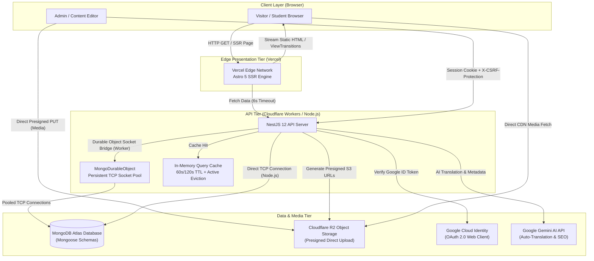

# GovtPariksha Platform (ExamResource Monorepo)

Production-grade government examination notifications, admit cards, answer keys, results, and study resources platform.

Built as a high-performance **monorepo** utilizing **Bun**, featuring an **Astro 5 SSR** web application deployed on Vercel and a **NestJS 12** backend deployable to Node.js or Cloudflare Workers backed by **MongoDB Atlas** via a **Cloudflare Durable Object Socket Proxy** and **Cloudflare R2** media storage.

---

## 🏛️ System Architecture Overview



---

## 🚀 Key Architectural & Performance Patterns

1. **Edge-Cached SSR with Instant Language Swapping**:
   - Astro SSR serves dynamic HTML with Vercel Edge caching (`Cache-Control: public, s-maxage=60-300, stale-while-revalidate=600`).
   - Articles are stored as separate documents per language (`HINGLISH` and `ENGLISH`) linked by `translationGroupId`.
   - The SSR payload bundles both versions. Client-side language switching occurs instantly via DOM class toggle and `history.pushState()` with **0ms network delay**.
2. **Dual-Runtime NestJS Backend**:
   - Runs natively on Node.js/Bun servers (`main.ts`) for local development or containerized production.
   - Compiles to **Cloudflare Workers** (`worker.ts`) using `@cloudflare/node`'s `httpServerHandler`.
3. **Cloudflare Durable Object Database Proxy**:
   - Serverless Workers proxy MongoDB connections via `MongoDurableObject` (`MONGO_DO`), maintaining persistent TCP connections and preventing database connection exhaustion.
4. **95+ Google PageSpeed Optimization**:
   - Critical layout styles inlined into `<head>`.
   - Google Tag Manager (GTM) and Google Analytics (GA4) are deferred to prevent render-blocking.
   - Zero Cumulative Layout Shift (CLS = 0.000) through explicit asset sizing and aspect-ratio boxes.
5. **Direct-to-R2 Media Uploads**:
   - CMS media uploads bypass the server using signed S3 URLs directly to Cloudflare R2, eliminating server memory spikes.

---

## 🚢 Production Deployment

Deployments to production are automated via Git. Pushing to **`main`** triggers the production pipeline for both Vercel (frontend) and Cloudflare Workers (backend).

### The Deployment Commands:
```bash
# 1. Run local pre-flight checks
bun run typecheck
bunx astro check
bun run lint
bun run test
bun run build

# 2. Push to main to trigger production builds
git checkout main
git add <files>
git commit -m "feat/fix: descriptive summary"
git push origin main
```

> [!IMPORTANT]
> `main` is our active production branch. All pushes to `main` trigger automatic production builds and deployments on Vercel and Cloudflare Workers.

---

## 📚 Version 2 Roadmap & Development (`feat/textbook-v2`)

Active development for **GovtPariksha Version 2** (including new textbook resources, comprehensive exam portals, mock test series, and question bank modules) takes place on the **`feat/textbook-v2`** branch:

- **Branch URL**: [https://github.com/Awaken-Core/examresource/tree/feat/textbook-v2](https://github.com/Awaken-Core/examresource/tree/feat/textbook-v2)
- Contributors should branch off `feat/textbook-v2` for Version 2 features.
- PRs for v2 features should target `feat/textbook-v2` prior to final stabilization into `main`.

For complete deployment details, pre-flight checks, and rollback instructions, see [docs/DEPLOYMENT.md](file:///c:/Users/Devil/Desktop/examresource/docs/DEPLOYMENT.md).

---

## 📁 Workspace Structure

```
examresource/
├── apps/
│   ├── client/                  # Frontend Web Application (Astro 5 SSR)
│   │   ├── src/
│   │   │   ├── components/      # Reusable UI & Blog components
│   │   │   ├── layouts/         # Layout.astro & AdminLayout.astro
│   │   │   ├── lib/             # API client, language swapping, reading time
│   │   │   ├── pages/           # Astro SSR pages (Home, Category, [slug], Admin)
│   │   │   └── styles/          # Global CSS & Tailwind design tokens
│   │   ├── astro.config.mjs     # Astro & Vercel adapter configuration
│   │   └── package.json
│   │
│   └── server/                  # Backend REST API (NestJS 12)
│       ├── src/
│       │   ├── core/            # Config, Zod validation, Durable Object proxy, schemas
│       │   ├── modules/         # Auth, Blog, Book, Exam, Media, Notifications, Question
│       │   ├── worker-shims/    # Cloudflare Worker shims (Sharp, optional Nest modules)
│       │   ├── bootstrap.ts     # Express application factory & security headers
│       │   ├── main.ts          # Node.js production entrypoint
│       │   └── worker.ts        # Cloudflare Workers entrypoint
│       ├── wrangler.jsonc       # Cloudflare Workers configuration
│       └── package.json
├── docs/                        # Complete technical documentation
│   ├── ARCHITECTURE.md          # In-depth system architecture & components
│   ├── DEPLOYMENT.md            # Git deployment workflow & env configs
│   ├── PERFORMANCE.md           # PageSpeed 95+ handling & caching strategies
│   ├── AUTH.md                  # Session security & Google OAuth
│   └── cloudflare-r2.md         # R2 bucket & presigned upload setup
├── AGENTS.md                    # Mandatory rules for AI coding assistants
├── package.json                 # Monorepo workspaces & unified commands
└── bun.lock                     # Bun dependency lockfile
```

---

## 🛠️ Local Development

### Prerequisites
- [Bun](https://bun.sh/) (v1.1+ recommended - **MANDATORY**: never use npm/yarn/pnpm)
- Node.js (v20+ or v22+)
- MongoDB Atlas cluster or local MongoDB instance

### 1. Installation
From the repository root:
```bash
bun install
```

### 2. Environment Configuration
Copy the example environment files:
```bash
cp apps/client/.env.example apps/client/.env
cp apps/server/.env.example apps/server/.env
```
Fill in the required values (see [docs/DEPLOYMENT.md](file:///c:/Users/Devil/Desktop/examresource/docs/DEPLOYMENT.md)).

### 3. Run Development Servers
Start both client and server concurrently:
```bash
bun run dev
```
- Client runs at: `http://localhost:3000`
- Server API runs at: `http://localhost:5000`

---

## 📜 Available Scripts

| Command | Description |
|---|---|
| `bun run dev` | Starts client (`:3000`) and server (`:5000`) concurrently in watch mode |
| `bun run build` | Builds both `apps/client` (Astro/Vercel) and `apps/server` (NestJS) |
| `bun run test` | Runs backend test suite via Vitest |
| `bun run typecheck` | Checks TypeScript compilation across the backend (`tsc --noEmit`) |
| `bunx astro check` | Typechecks and validates Astro frontend components and routes (`apps/client`) |
| `bun run check` | Runs full typecheck across backend and frontend (`bun run typecheck && bun run check:client`) |
| `bun run lint` | Runs linter across the backend code (`oxlint`) |

---

## 📚 Technical Documentation Index

- **[AGENTS.md](file:///c:/Users/Devil/Desktop/examresource/AGENTS.md)**: AI agent instructions, coding constraints (Bun only, no hardcoded URLs), UI/UX skills references.
- **[docs/DEPLOYMENT.md](file:///c:/Users/Devil/Desktop/examresource/docs/DEPLOYMENT.md)**: Production release guide (`main` branch trigger), Version 2 development workflow, environment variables, rollbacks.
- **[docs/ARCHITECTURE.md](file:///c:/Users/Devil/Desktop/examresource/docs/ARCHITECTURE.md)**: Complete architecture, dual-runtime Cloudflare Worker/Node.js, Durable Object proxy.
- **[docs/PERFORMANCE.md](file:///c:/Users/Devil/Desktop/examresource/docs/PERFORMANCE.md)**: PageSpeed 95+ optimizations, Web Vitals, Edge caching headers, deferred scripts, bilingual DOM swap.
- **[docs/AUTH.md](file:///c:/Users/Devil/Desktop/examresource/docs/AUTH.md)**: Custom session authentication, Argon2id hashing, Google OAuth 2.0 flow.
- **[docs/cloudflare-r2.md](file:///c:/Users/Devil/Desktop/examresource/docs/cloudflare-r2.md)**: Cloudflare R2 bucket setup and CORS configuration.
