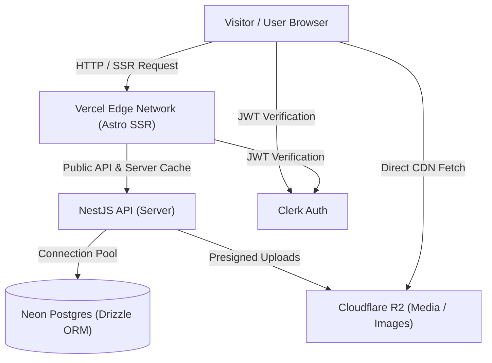

# GovtPariksha Platform (ExamResource Monorepo)

Production-grade government examination notifications, admit cards, answer keys, results, and study resources platform.

Built as a high-performance **monorepo** utilizing **Bun**, featuring an **Astro SSR** web application deployed on Vercel and a **NestJS** backend deployed on Node/Cloudflare Workers backed by **Neon Postgres** via **Drizzle ORM**.

---

## 🏛️ Architecture Overview



### Workspace Structure

```
examresource/
├── apps/
│   ├── client/                  # Frontend Web Application (Astro SSR)
│   │   ├── src/
│   │   │   ├── components/      # Reusable UI & Blog components
│   │   │   ├── layouts/         # Layout.astro & AdminLayout.astro
│   │   │   ├── lib/             # API client, language swapping, notifications
│   │   │   ├── pages/           # Astro SSR pages (Home, Category, [slug], Admin)
│   │   │   └── styles/          # Global CSS & Tailwind design tokens
│   │   ├── astro.config.mjs     # Astro & Vercel adapter configuration
│   │   └── package.json
│   │
│   └── server/                  # Backend REST API (NestJS 12)
│       ├── src/
│       │   ├── core/            # Config, environment validation, Drizzle schema
│       │   ├── modules/
│       │   │   ├── blog/        # Articles, blocks, categories, tags, cache, AI
│       │   │   ├── clerk-auth/  # Clerk authentication & user sync
│       │   │   ├── media/       # Cloudflare R2 uploads & presigned URLs
│       │   │   └── notifications/# Web notifications & push alerts
│       │   └── bootstrap.ts     # Express application factory & security headers
│       └── package.json
├── package.json                 # Monorepo workspaces & unified commands
└── bun.lock                     # Bun dependency lockfile
```

---

## 🚀 Key Architectural Patterns

1. **Edge-Cached SSR with Instant Language Swapping**:
   - Astro SSR serves HTML dynamically with Vercel Edge caching (`s-maxage=60-300`).
   - Articles are stored as separate rows per language (`HINGLISH` and `ENGLISH`) linked by `translationGroupId`.
   - `getPublished` bundles both versions in the SSR response; client-side language switching occurs instantly via DOM swap (`history.pushState()`) without a round-trip or page reload.
2. **Server-Side In-Memory Cache**:
   - `BlogService` maintains a fast `MemoryCache` with TTLs (60s listing, 120s article) and active cache invalidation on any create, update, reorder, or delete operation.
3. **Resilient SSR & Network Guardrails**:
   - All server-side data fetching uses `AbortSignal.timeout(6000)` to prevent serverless function hangs during cold starts or transient spikes.
4. **Optimistic Concurrency & Revision History**:
   - Editorial article updates utilize version checks and revision history tracking to protect against conflicting concurrent edits.

---

## 🛠️ Getting Started

### Prerequisites

- [Bun](https://bun.sh/) (v1.1+ recommended)
- Node.js (v20+ or v22+)
- Postgres database (e.g. Neon, Supabase, or local Postgres)
- Clerk account for authentication

### 1. Installation

From the workspace root:

```bash
bun install
```

### 2. Environment Configuration

Copy the example environment files:

```bash
cp apps/client/.env.example apps/client/.env
cp apps/server/.env.example apps/server/.env
```

Fill in required keys:
- **`apps/server/.env`**: `DATABASE_URL`, `CLERK_SECRET_KEY`, `CLIENT_URL`, `SERVER_URL`.
- **`apps/client/.env`**: `PUBLIC_CLERK_PUBLISHABLE_KEY`, `CLERK_SECRET_KEY`, `PUBLIC_API_URL`, `PUBLIC_SITE_URL`.

### 3. Database Migration

Push or run migrations on your database:

```bash
bun run db:push
# or
bun run db:migrate
```

### 4. Running Development Servers

Start both client and server concurrently:

```bash
bun run dev
```

- Client runs at: `http://localhost:3000`
- Server API runs at: `http://localhost:4000`

---

## 📜 Available Scripts

| Command | Description |
|---|---|
| `bun run dev` | Starts client and server concurrently in development mode |
| `bun run build` | Builds both `apps/client` (Astro/Vercel) and `apps/server` (NestJS) |
| `bun run test` | Runs server test suites via Vitest |
| `bun run typecheck` | Checks TypeScript compilation across the backend |
| `bun run lint` | Runs linter on backend files |
| `bun run db:push` | Syncs Drizzle schema changes directly to the database |
| `bun run db:generate` | Generates SQL migration files from schema |
| `bun run db:studio` | Launches Drizzle Studio GUI for inspecting database rows |

---

## 🚢 Production Deployment

- **Frontend (`apps/client`)**: Deployed to Vercel via `@astrojs/vercel`. Ensure `CLERK_SECRET_KEY` and all `PUBLIC_*` environment variables are configured in the Vercel dashboard.
- **Backend (`apps/server`)**: Deployable to Cloudflare Workers via Wrangler or to VPS/Railway/Render as a Node.js process using `bun run start:prod`.
- **Database**: When using Neon in production, ensure `DATABASE_URL` connects through the pooled endpoint (`-pooler.region.neon.tech`) with PgBouncer.
