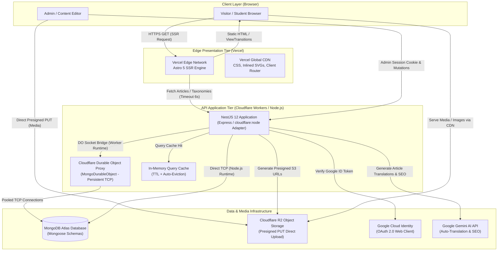

# System Architecture (ARCHITECTURE.md)

This document provides a comprehensive architectural deep-dive of the **GovtPariksha / ExamResource** platform, including component boundaries, data flows, dual-runtime backend execution, security guarantees, and content rendering patterns.

---

## 🏛️ High-Level System Architecture



---

## 📁 Monorepo Workspace Structure

The project uses **Bun workspaces** declared in the root `package.json`:

```
examresource/
├── apps/
│   ├── client/                  # Web Frontend (Astro 5 SSR)
│   │   ├── src/
│   │   │   ├── assets/          # Static logos and vector icons
│   │   │   ├── components/      # UI components (Header, Footer, LeftSidebar, ArticleCard, etc.)
│   │   │   ├── data/            # Static navigation, site metadata, social channels
│   │   │   ├── layouts/         # Layout.astro (Public SSR) & AdminLayout.astro (CMS Dashboard)
│   │   │   ├── lib/             # API client, instant language swap, reading time, bookmarks
│   │   │   ├── pages/           # Astro file-based routes
│   │   │   │   ├── index.astro  # Homepage with category grids and live feeds
│   │   │   │   ├── [slug].astro # Article display with instant language DOM swap
│   │   │   │   ├── category/    # Categorized article listings
│   │   │   │   ├── admin/       # Editorial CMS and blog publishing dashboard
│   │   │   │   ├── login.astro  # Student/Admin login page
│   │   │   │   └── api/         # Contact submission and proxy endpoints
│   │   │   └── styles/          # Tailwind CSS v4 and custom typography design tokens
│   │   └── astro.config.mjs     # Astro configuration with Vercel adapter
│   │
│   └── server/                  # Backend REST API (NestJS 12)
│       ├── src/
│       │   ├── core/
│       │   │   ├── config/      # Environment validation via Zod (env.ts)
│       │   │   ├── database/    # Database module, MongoDurableObject, DurableModel proxy
│       │   │   └── schema/      # Mongoose schemas (User, Session, Blog, Book, Exam, etc.)
│       │   ├── modules/
│       │   │   ├── auth/        # Custom session auth, Argon2id, Google OAuth, CSRF guards
│       │   │   ├── blog/        # Article CRUD, revisions, cache, Gemini AI translation
│       │   │   ├── book/        # Study resources and textbooks
│       │   │   ├── exam/        # Examination notifications, syllabus, admit cards
│       │   │   ├── media/       # Cloudflare R2 presigned URLs
│       │   │   ├── notifications/# Web push notifications and broadcast alerts
│       │   │   └── question/    # Question bank, previous year papers, quizzes
│       │   ├── worker-shims/    # Cloudflare Worker shims (Sharp, NestJS optional modules)
│       │   ├── bootstrap.ts     # Express application factory with security headers
│       │   ├── main.ts          # Node.js/Bun production entrypoint
│       │   └── worker.ts        # Cloudflare Workers entrypoint
│       └── wrangler.jsonc       # Wrangler Worker deployment settings
├── docs/                        # Architecture, Deployment, Performance guides
├── .agents/skills/              # Specialized UI/UX & NestJS design rules
└── bun.lock                     # Bun dependency lockfile
```

---

## 🎨 Frontend Architecture (`apps/client`)

### 1. Astro 5 Server-Side Rendering (SSR)
- **Deployment**: Runs on Vercel Edge/Serverless using `@astrojs/vercel` with `output: 'server'`.
- **Hybrid Island Architecture**:
  - The public-facing site (Home, Category, Article pages) is rendered as **pure, high-performance HTML/CSS** with zero client JavaScript runtime overhead.
  - Interactive islands are injected selectively using `@astrojs/react` for heavy interactive components:
    - TipTap WYSIWYG editor in the `/admin` CMS.
    - Interactive Search Modal (`SearchModal.astro`).
    - Contact Form with interactive validation.
- **ClientRouter & View Transitions**:
  - Incorporates `ClientRouter` from `astro:transitions`.
  - Enables fluid SPA-like page transitions without reloading the page.
  - Preserves scroll positions and eliminates white flash between navigations.

### 2. Instant Bilingual Language Swapping Pattern
A signature feature of the platform is zero-latency switching between **Hinglish** and **English**:
- In MongoDB, articles are stored as independent documents per language (`HINGLISH` and `ENGLISH`), tied together via `translationGroupId`.
- When an article is requested via SSR, `getPublished` fetches both the primary language article and its sibling translation.
- Both versions are rendered into the HTML document inside distinct container elements:
  - `<div id="article-lang-hinglish" ...>`
  - `<div id="article-lang-english" ...>`
- The client-side script (`article-lang-swap.ts`) toggles their visibility instantaneously using CSS classes and updates the browser URL bar via `window.history.pushState()`:
  - **No network round-trip**
  - **No page re-render**
  - **Zero latency for the user**

---

## ⚙️ Backend Architecture (`apps/server`)

### 1. Dual-Runtime Execution (Node.js & Cloudflare Workers)
The NestJS 12 application is designed to run in two distinct runtime environments without changing business logic:

1. **Standard Node.js / Bun Runtime (`main.ts`)**:
   - Uses standard Express platform (`@nestjs/platform-express`).
   - Connects directly to MongoDB via native Mongoose connection pooling.
   - Ideal for local development (`bun run start:dev`) and traditional containerized deployments (Docker/VPS/Railway).

2. **Cloudflare Workers Runtime (`worker.ts`)**:
   - Uses `@cloudflare/node`'s `httpServerHandler` to run the Express app within the Worker execution context.
   - Employs runtime shims (`worker-shims/`) for heavy C++ native libraries:
     - `sharp` is shimmed with Cloudflare Images API.
     - Optional NestJS microservice dependencies are stubbed to keep the worker bundle under size limits.

### 2. Cloudflare Durable Object Database Proxy (`MONGO_DO`)
Serverless edge workers terminate sockets on idle, which causes severe connection exhaustion if connecting directly to MongoDB. To solve this:
- Outbound database operations are routed through `MongoDurableObject` (`core/database/mongo-durable-object.ts`).
- The Durable Object maintains a long-lived, pooled TCP connection to MongoDB.
- Mongoose queries from worker invocations serialize requests across the internal binding to the Durable Object, ensuring zero connection storms and optimal latency.

### 3. Media Pipeline: Direct-to-R2 Signed Uploads
Media files never pass through the API server memory:
1. Admin requests an upload presigned URL: `POST /api/v1/media/upload-url` with file metadata (`fileName`, `contentType`, `fileSize`).
2. API validates file type (JPEG, PNG, WebP, GIF) and size (<= 10MB), then signs an S3-compatible `PutObjectCommand` using `@aws-sdk/s3-request-presigner`.
3. Browser performs direct HTTP `PUT` to Cloudflare R2 bucket.
4. Images are served globally via Cloudflare CDN domain (`R2_PUBLIC_BASE_URL`).

---

## 🛡️ Authentication & Security Model

```mermaid
sequenceDiagram
    participant Browser as Browser Client
    participant API as NestJS API (/api/v1)
    participant Google as Google Identity
    participant DB as MongoDB

    Note over Browser,API: Password Login Flow
    Browser->>API: POST /auth/login { email, password }
    API->>DB: Find user by email
    API->>API: Verify password with Argon2id
    API->>DB: Create Session (Store SHA-256 hash of token)
    API-->>Browser: Set-Cookie: __Host-sid=<token>; HttpOnly; Secure; SameSite=Lax

    Note over Browser,API: Google OAuth Flow
    Browser->>API: GET /auth/google
    API-->>Browser: Redirect to Google OAuth Consent
    Browser->>Google: Authenticate & Authorize
    Google-->>API: GET /auth/google/callback?code=...
    API->>Google: Exchange code for Google ID Token
    API->>API: Verify Google ID token audience & email
    API->>DB: Find or create User & active Session
    API-->>Browser: Set-Cookie: __Host-sid=<token> & Redirect to /admin

    Note over Browser,API: Authenticated Mutation Guard
    Browser->>API: POST /blog (Cookie: __Host-sid, Header: X-CSRF-Protection: 1)
    API->>API: Validate Origin == CLIENT_URL & CSRF Header present
    API->>DB: Lookup session by SHA-256(sid)
    API-->>Browser: 200 OK (Resource created/updated)
```

### Security Guardrails:
1. **Opaque Tokens**: Raw session tokens are never saved in the database; only SHA-256 hashes are persisted.
2. **Cookie Hardening**: In production, the session cookie is named `__Host-sid`, enforcing `Secure`, `HttpOnly`, `SameSite=Lax`, and `Path=/`.
3. **CSRF Protection**: State-changing requests (`POST`, `PUT`, `DELETE`) require the `X-CSRF-Protection: 1` header and validate the `Origin` header against `CLIENT_URL`.
4. **Argon2id Hashing**: Passwords use memory-hard Argon2id hashing algorithms.

---

## 🔮 Version 2 Architecture & Roadmap (`feat/textbook-v2`)

The next phase of platform evolution is actively designed and maintained on the **`feat/textbook-v2`** branch:
- **Repository Branch**: [https://github.com/Awaken-Core/examresource/tree/feat/textbook-v2](https://github.com/Awaken-Core/examresource/tree/feat/textbook-v2)
- **Production Target**: `main` (auto-deploys to Vercel and Cloudflare Workers)

### Version 2 Core Initiatives:
1. **Textbook & Curriculum Modules**: Dedicated chapters, subject breakdowns, topic hierarchies, and interactive study guides.
2. **Comprehensive Exam Portals**: Live test series engine, mock test execution with timer countdowns, and question-by-question scoring.
3. **Expanded Question Bank**: Rich-text questions with bilingual explanations, formula formatting, and diagram embeds.
4. **Client-Side Ergonomics**: Zero-auth local favorites, seamless Web Share API integration, and instant language swapping without URL pollution.

