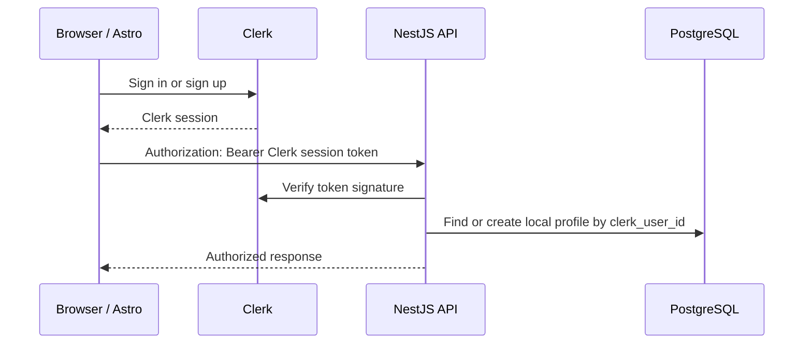

# Clerk authentication

This document explains the Clerk authentication implementation in ExamResource: what was replaced, where each part lives, how browser requests reach NestJS, and what must be configured before deployment.

## Overview

Clerk owns identity authentication: sign-up, sign-in, password reset, email verification, social providers, sessions, and multi-factor authentication. The application database still owns ExamResource-specific data: local profile ID, role, account status, blog authorship, and future business data.



The browser never sends a password to NestJS and NestJS never creates its own login cookie.

## What was replaced

The former custom authentication module handled password hashing, registration, login, a `sid` session cookie, Google OAuth, email verification, password reset, and session revocation. Those routes are no longer loaded by the NestJS application.

Clerk now handles those functions. Legacy user and token tables are deliberately retained for the initial migration so existing data is not deleted. They are not used by the active authentication flow and may be removed only in a later, separately tested database cleanup.

## Client application (`apps/client`)

| Location | Responsibility |
| --- | --- |
| `astro.config.mjs` | Enables SSR, the Node adapter, and the Clerk Astro integration. |
| `src/middleware.ts` | Initializes Clerk authentication for every Astro request. |
| `src/components/AuthPage.astro` | Mounts Clerk's sign-in or sign-up UI. |
| `src/pages/login.astro` | Renders Clerk sign-in. |
| `src/pages/signup.astro` | Renders Clerk sign-up. |
| `src/pages/home.astro` | Requires a signed-in Clerk user; loads the local profile with a bearer token and signs out through Clerk. |
| `src/pages/admin.astro` | Requires sign-in, then allows only the local `admin` role. |
| `src/pages/editor.astro` | Requires sign-in, then allows local `editor` or `admin` roles. |
| `.env.example` | Lists the client configuration values. |

### Page protection

`home.astro`, `admin.astro`, and `editor.astro` call `Astro.locals.auth()` on the server. Guests are redirected to Clerk sign-in before the page is rendered.

Admin/editor pages then call `GET /api/v1/me` with the Clerk token and redirect users without the required local role to `/home`. This browser check improves the page experience; the API remains the authority for every protected data operation.

### Calling the API

Because Astro and NestJS are separate services, client code requests a Clerk session token and supplies it to NestJS:

```ts
const token = await window.Clerk?.session?.getToken();
await fetch(`${apiUrl}/me`, {
  headers: token ? { Authorization: `Bearer ${token}` } : {},
});
```

Use this pattern for every future protected client API call. Do not add back the former `sid` cookie or trust a user object saved in local storage.

## Server application (`apps/server`)

| Location | Responsibility |
| --- | --- |
| `src/modules/clerk-auth/clerk-auth.service.ts` | Extracts the bearer token, verifies it using Clerk, creates/links the local profile, and rejects suspended users. |
| `src/modules/clerk-auth/clerk-auth.controller.ts` | Provides `GET /api/v1/me` and receives Clerk webhook events. |
| `src/modules/clerk-auth/clerk-auth.module.ts` | Exports `ClerkAuthService` for other modules. |
| `src/modules/blog/blog.controller.ts` | Uses `ClerkAuthService` instead of the old custom session service. |
| `src/core/schema/users.ts` | Adds the unique, indexed `clerk_user_id` local identity link. |
| `src/main.ts` | Enables raw request bodies needed to validate webhook signatures. |
| `.env.example` | Lists server configuration values. |

### Token verification

`ClerkAuthService.requireUser()` accepts only an `Authorization: Bearer <token>` header. It uses Clerk's backend SDK to verify the signed session token. A missing, malformed, expired, or invalid token receives HTTP 401.

Once the token is valid, the `sub` claim is treated as the Clerk user ID. The service obtains or creates the linked local row in `users`; `status = suspended` receives HTTP 403 even when the Clerk session itself is valid.

### Local roles

The application role remains a database concern:

| Role | Access |
| --- | --- |
| `student` | Normal signed-in functionality. |
| `editor` | Can manage their own blogs. |
| `admin` | Can manage all blogs and access the admin area. |

New Clerk users start as `student` because that is the database default. Promote trusted staff directly in the `users.role` column. Do not use an email address alone as authorization.

### Webhook endpoint

`POST /api/v1/webhooks/clerk` verifies the Standard Webhooks signature before taking action.

Handled events:

- `user.created` — creates or links the local profile.
- `user.updated` — refreshes name, email, phone, and verification status.
- `user.deleted` — suspends the linked local profile rather than deleting records that may own content.

The endpoint needs the untouched request body, which is why Nest is created with `rawBody: true`.

## Environment configuration

Copy the example files without committing real keys:

```powershell
Copy-Item apps/client/.env.example apps/client/.env
Copy-Item apps/server/.env.example apps/server/.env
```

Set these values:

| Application | Variable | Source |
| --- | --- | --- |
| Client | `PUBLIC_CLERK_PUBLISHABLE_KEY` | Clerk Dashboard → API Keys. |
| Client | `CLERK_SECRET_KEY` | Clerk Dashboard → API Keys. Required by Astro's server-side Clerk middleware; do **not** prefix it with `PUBLIC_`. |
| Client | `PUBLIC_CLERK_SIGN_IN_URL` | `/login`. |
| Client | `PUBLIC_CLERK_SIGN_UP_URL` | `/signup`. |
| Client | `PUBLIC_API_URL` | NestJS public API base URL. |
| Server | `CLERK_SECRET_KEY` | Clerk Dashboard → API Keys. Keep secret. |
| Server | `CLERK_WEBHOOK_SIGNING_SECRET` | Clerk Dashboard → Webhooks → endpoint secret. Keep secret. |
| Server | `DATABASE_URL` | PostgreSQL connection string. |
| Server | `CLIENT_URL` | The Astro application's public URL. |

Use development Clerk keys locally and production keys only on the production deployment. `CLERK_SECRET_KEY` is required in both deployed server environments (`apps/client` for Astro SSR and `apps/server` for NestJS), but must never use a `PUBLIC_` prefix or be exposed to browser code.

## Clerk Dashboard setup

1. Create a Clerk application for ExamResource.
2. In **User & Authentication**, enable email/password and any required social providers. Enable Google here instead of configuring Google OAuth in NestJS.
3. Configure email verification and password policy in Clerk.
4. Add the production domain and local development origins in Clerk's allowed origins/domain configuration.
5. Create a webhook endpoint pointing to `https://YOUR_API_DOMAIN/api/v1/webhooks/clerk`.
6. Select `user.created`, `user.updated`, and `user.deleted` events.
7. Copy the webhook signing secret into the server environment.
8. If administrators require MFA, enforce it using Clerk's policies for the relevant users/organization.

## Database rollout

The Drizzle schema adds `users.clerk_user_id`, a unique index, and makes the legacy `password_hash` nullable so Clerk-created users do not need an application password.

- New or disposable database: run the committed migration with `bun run db:migrate`.
- Existing database created outside the committed migration history: review and run `bun run db:push` in a controlled environment first. Take a backup before production schema changes.

For existing users, passwords cannot be migrated to Clerk because stored password hashes cannot be safely transferred. Create/import matching Clerk users by verified email and have them set a Clerk password through the normal reset flow. On first authenticated API request or the user webhook, the existing local row is linked to the Clerk ID by matching email. Resolve any duplicate-email conflict manually before granting access.

## Development and verification

```powershell
bun run dev
bun run --cwd apps/client build
bun run --cwd apps/server build
bun run --cwd apps/server test
```

Verify these flows against a real Clerk development instance:

1. Sign up with email/password and sign in with Google, if enabled.
2. Confirm `/home` redirects guests to sign-in.
3. Confirm `GET /api/v1/me` rejects requests without a bearer token.
4. Confirm a new Clerk user creates a local `student` profile.
5. Promote a user to `editor` and verify blog endpoints work only for that user’s content.
6. Promote a user to `admin` and verify admin-only access.
7. Suspend a local profile and confirm API access is rejected.
8. Send Clerk test webhook events and confirm signature verification and profile synchronization.

## Troubleshooting

| Symptom | Check |
| --- | --- |
| Clerk UI does not load | Confirm `PUBLIC_CLERK_PUBLISHABLE_KEY` is present in `apps/client/.env`, then restart Astro. |
| API returns 401 | Confirm the browser sends `Authorization: Bearer <Clerk token>` and the server has the matching `CLERK_SECRET_KEY`. |
| API returns 403 | Check the local `users.status` and `users.role` values. |
| User has no local profile | Check database connectivity, email availability in Clerk, and webhook/API server logs. |
| Webhook reports an invalid signature | Check the endpoint secret and ensure any proxy preserves `svix-*` headers and request body. |
| Sign-in redirects incorrectly | Confirm the Clerk sign-in/sign-up URL environment values and deployment domain configuration. |

## Security rules

- Treat Clerk as the authentication authority and NestJS as the authorization enforcement point.
- Verify every API token on the server; client redirects are not security controls.
- Keep Clerk server keys and webhook signing secrets out of Git and browser variables.
- Use role checks in every protected API handler, not only Astro pages.
- Preserve legacy authentication data until migration is complete and backed up; remove it only through a reviewed follow-up migration.

## References

- [Clerk Astro quickstart](https://clerk.com/docs/astro/getting-started/quickstart)
- [Clerk session token verification](https://clerk.com/docs/guides/sessions/manual-jwt-verification)
- [Clerk webhook synchronization guide](https://clerk.com/docs/guides/development/webhooks/syncing)
