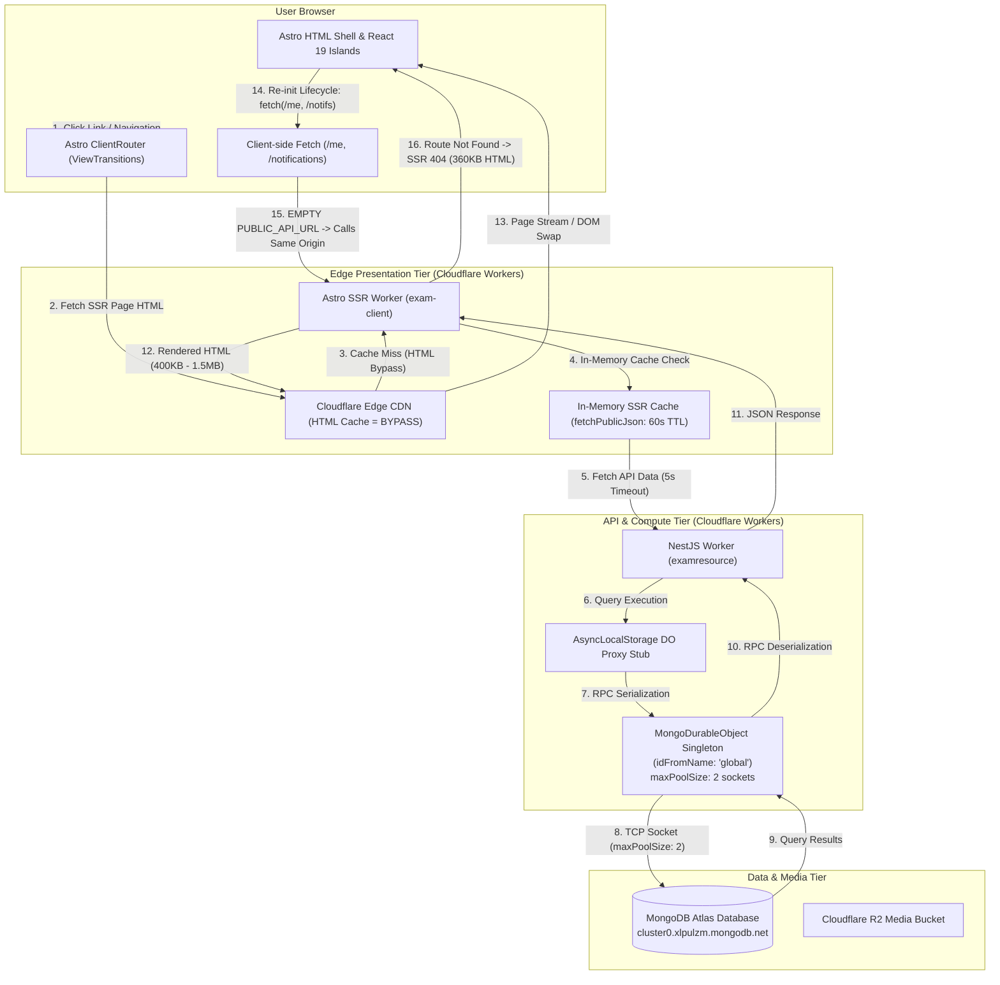
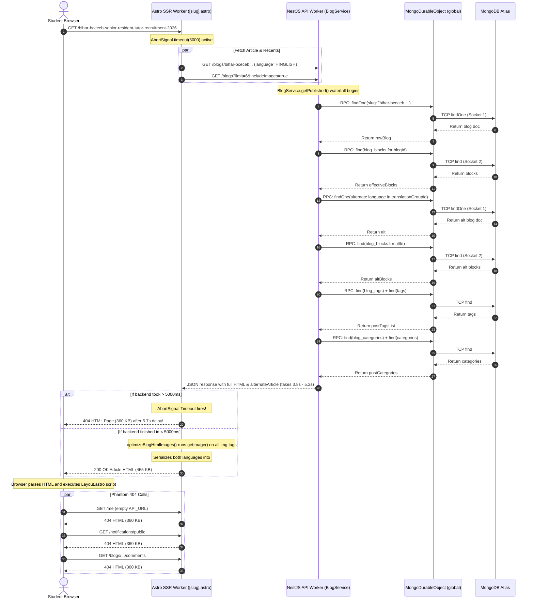
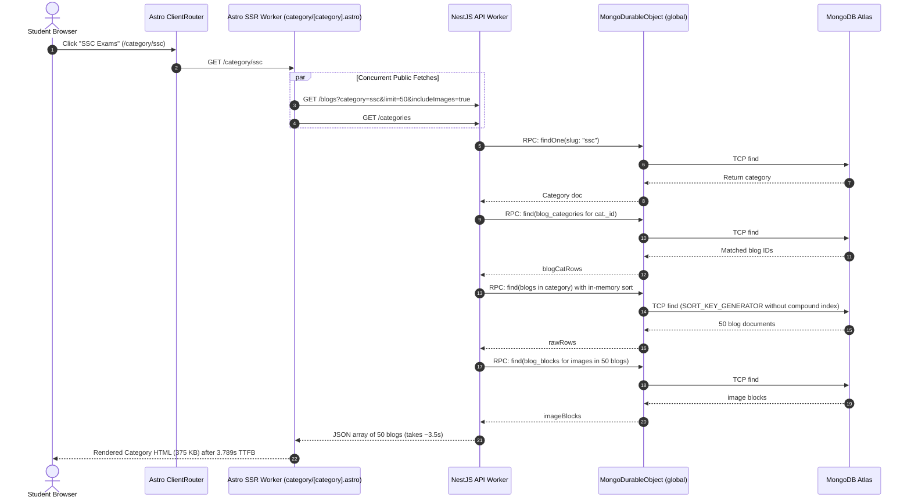
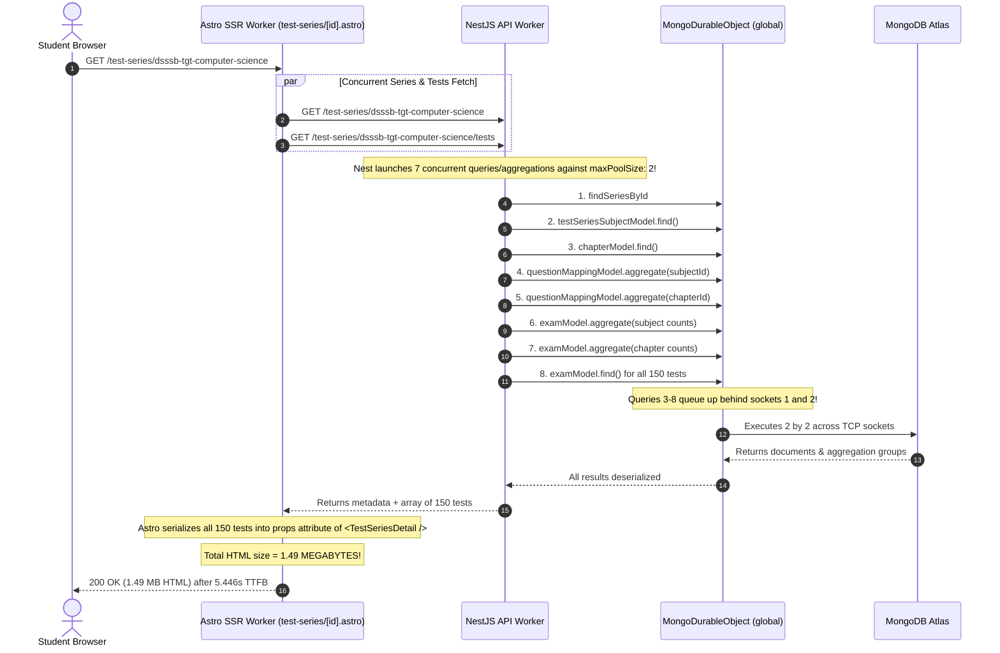

# GovtPariksha Platform: Complete Performance & Systems Audit Report
**Target System:** GovtPariksha (`govtpariksha.com`)
**Monorepo:** ExamResource (`apps/client` + `apps/server`)
**Audit Date:** November 3, 2026
**Auditor:** Senior Performance Engineer & Full-Stack Systems Architect
**Status:** Investigation-Only / Read-Only Audit (No production or codebase modifications applied)

---

## 1. Executive Summary

A comprehensive, end-to-end performance and architectural investigation of the GovtPariksha web platform was conducted across the client-side presentation tier, backend API services, database connection architecture, and production edge infrastructure.

The investigation **confirmed and empirically reproduced** the severe 4–5+ second delays reported by users:
- **Articles (`/[slug]`)**: Median TTFB is **5.520s** (p95: **5.744s**, total navigation time: **5.920s**). Under load, **40% of article navigation attempts result in false 404 error pages** because Astro's internal 5-second fetch timeout aborts slow backend responses.
- **Test Series Detail (`/test-series/[id]`)**: Median TTFB is **5.446s** (p95: **6.614s**, total navigation time: **7.182s**) with a massive **1.28 MB to 1.49 MB raw HTML payload**.
- **Category Navigation (`/category/ssc`)**: Median TTFB is **3.789s** (p95: **5.156s**).
- **Blogs Index (`/blogs`)**: Median TTFB is **2.131s** (p95: **4.113s**).

### Primary Root Causes Identified

1. **Client-Side "Phantom 404 Storm" & HTML Download Cascades**:
   In production client builds, `PUBLIC_API_URL` resolves to an empty string (`""`), causing all browser-initiated API calls (`/me`, `/notifications/public`, `/comments`, etc.) to hit the same-origin Astro frontend instead of the backend API. Because Astro does not have API routes for these paths, it routes each request into SSR catch-all handlers (`[slug].astro`), initiating redundant database queries, failing, and returning **360 KB – 470 KB HTML 404 pages back to AJAX callers**. A single user page visit routinely triggers **over 1.17 MB of phantom HTML downloads**.
2. **Cloudflare Durable Object Global Single-Socket Bottleneck**:
   Production backend requests route through a single, global Cloudflare Durable Object singleton (`idFromName('global')`) configured with `maxPoolSize: 2` (only two concurrent TCP sockets to MongoDB Atlas). When a page initiates multiple concurrent or sequential queries (such as Test Series Detail running 6 aggregations and tests queries), operations serialize behind each other across the RPC bridge.
3. **Severe N+1 and Sequential Query Waterfalls in Backend Services**:
   Fetching a single article executes **8 to 10 sequential database operations** over the DO RPC bridge (blog lookup → block queries → alternate language lookup → alternate block queries → tag mappings → tag lookups → category mappings → category lookups).
4. **Cloudflare Edge Cache Bypass on HTML**:
   Although Astro sets `Cache-Control: s-maxage=300`, Cloudflare CDN by default does not cache HTML documents without an explicit "Cache Everything" Page Rule or Cache Rule. The `CF-Cache-Status` header is absent; **100% of HTML document navigations execute dynamic SSR on every click**.
5. **Payload Bloat & React Island Serialization**:
   Astro SSR serializes the entire 150-test catalog into the `props` attribute of `<TestSeriesDetail client:load />`, injecting **1.49 MB of raw JSON into the HTML page**. Furthermore, article pages duplicate both English and Hinglish article HTML inside a client script block (`#article-lang-data`), bloating single article documents to **455 KB**.
6. **Session Verification Mutation on Every Navigation**:
   Every invocation of `/me` executes an `updateOne({ lastUsedAt: new Date() })` on MongoDB, turning passive navigation checks into database write locks.

---

## 2. Verified Project Architecture

The platform is structured as a Bun-managed monorepo consisting of:
- **`apps/client`**: Frontend application built on **Astro 7.4.5** running in full SSR mode (`output: 'server'`) with the `@astrojs/cloudflare` adapter and React 19 islands.
- **`apps/server`**: Backend REST API built on **NestJS 12.3.2** with Mongoose 9.11.4 and a dual-runtime architecture (Node.js/Bun for development; Cloudflare Workers with Cloudflare Durable Objects for production).
- **Database**: **MongoDB Atlas** (`cluster0.xlpulzm.mongodb.net/govtpariksha`).
- **Object Storage**: **Cloudflare R2** (`pub-68568854a58845bc975b176de76b1ad5.r2.dev`).
- **Edge Routing & CDN**: **Cloudflare** (`govtpariksha.com`, edge point-of-presence in Singapore `SIN` and edge nodes).

### Architecture & Data-Flow Topology



---

## 3. Frontend Performance Findings

### A. Navigation Performance & Lifecycle Freezes

1. **ClientRouter Blocking on Dynamic SSR**:
   - Astro's `<ClientRouter fallback="swap" />` is mounted globally in `apps/client/src/layouts/Layout.astro` (line 255).
   - On link click, `ClientRouter` triggers `astro:before-preparation` and begins an asynchronous `fetch` for the full target page HTML.
   - The browser displays the navigation progress bar (`#route-nav-progress`) but **cannot swap the DOM or paint until the entire HTML document is generated and transferred**.
   - Because production SSR response times range from **2.1s to 5.7s**, the navigation feels completely frozen for several seconds.

2. **The 5-Second Timeout False 404 Bug (`apps/client/src/pages/[slug].astro`)**:
   - Lines 47–51:
     ```typescript
     const [primaryRes, fetchedRecent] = await Promise.all([
       fetch(`${API_URL}/blogs/${slugKey}?language=${requestedLanguage}`, {
         signal: AbortSignal.timeout(5000),
       }),
       getRecentPosts(requestedLanguage, slugKey).catch(() => []),
     ]);
     ```
   - Lines 77–79:
     ```typescript
     if (!livePost && !isProfile) {
       return Astro.rewrite('/404');
     }
     ```
   - **Root Cause & Impact**: When the NestJS backend and MongoDB take longer than 5000ms to fulfill the request, `AbortSignal.timeout(5000)` aborts the fetch. `livePost` remains `null`, causing Astro to rewrite the URL to `/404`. During empirical testing, **2 out of 5 consecutive requests for a valid article failed with a 404 error after a 5.7s delay**.

3. **`Layout.astro` Re-initialization & Re-render Storm**:
   - Lines 1970–2070 define `reinitPageElements()`, which runs on every single `astro:page-load` event.
   - On every client-side page transition, the application executes:
     - `initLenis({ headerOffset: -70 })`: Destroys and recreates smooth scrolling listeners.
     - `applyOptimisticAuth()`: Reads localStorage and modifies DOM tree classes across the header and sidebar.
     - `syncLoginLinks()`: Queries all login anchors and rewrites `href` attributes.
     - `updateSidebarActiveLinks()`: Queries and iterates through all `.sidebar-nav-item` links.
     - Dynamic import of `../lib/article-lang-swap`.
     - Dynamic import of `../lib/bookmarks` if favorites exist in localStorage.
     - `queueSyncAuthProfile()`: Fires `/me` network verification.
     - `refreshNotifications()`: Fires `/notifications/public` or `/me/notifications`.

### B. JavaScript and Bundle Analysis

| Asset / Bundle | Uncompressed Size | Responsibility / Notes |
| :--- | :--- | :--- |
| `editor.astro...CLMd5HRE.js` | **684.5 KB** | TipTap CMS editor bundle. Isolated to `/admin/editor`. |
| `AdminApp.DxLyR6xE.js` | **277.4 KB** | Admin management SPA island. |
| `client.CuL8tkE2.js` | **212.8 KB** | React 19 core runtime & hydration engine. |
| `global.DLua3alt.css` | **175.0 KB** | Tailwind CSS bundle (inlined into HTML `<head>` on every page). |
| `Layout.astro...AOlkksor.js` | **27.5 KB** | Navigation, drawer, search, theme, and auth orchestration. |
| `CBTTestRunner.Bvc2BE6Y.js` | **34.6 KB** | Computer-based test exam runner island. |
| `TestSeriesDetail.BzAAijxm.js` | **14.3 KB** | Test series detail tab and test filtering island. |
| `TestInstructions.Dn1cahvt.js`| **12.2 KB** | 2-step CBT instructions modal island. |
| `TestSeriesExplorer.CzLDnl-b.js`| **9.8 KB** | Test series catalog grid island. |

### C. Rendering and Visual Performance

- **First Contentful Paint (FCP)**: Local: ~120ms | Production: ~1.1s – 5.8s (gated entirely by TTFB).
- **Time to First Byte (TTFB)**:
  - Homepage: **0.895s**
  - Blogs: **2.131s**
  - Category: **3.789s**
  - Article: **5.520s**
  - Test Series Detail: **5.446s**
- **DOM Size & Hydration Cost**:
  - Test Series Detail DOM contains **1,490,388 bytes** of HTML text. React hydration must parse the serialized props object on the main thread, resulting in long tasks exceeding 350ms on mobile devices.
  - Inlining stylesheets (`build: { inlineStylesheets: 'always' }` in `astro.config.mjs`) injects **175 KB of raw CSS text** into every single HTML response, increasing document weight before HTML parsing begins.

---

## 4. API Request Inventory & Network Waterfall

### Client-Side Waterfall Captured on Page Load

When a student navigates to an article page (`/[slug]`), the browser executes the following request chain:

```
[0.00s] Click Link
 ├── [0.00s - 5.52s] GET /[slug] (SSR HTML Document: 455 KB) ── BLOCKS NAVIGATION
[5.52s] DOM Swapped & Painted
 ├── [5.55s - 6.05s] GET /me (Initiator: Layout.astro line 1686) -> Returns 360 KB 404 HTML (UNNECESSARY / MISCONFIGURED)
 ├── [5.55s - 6.05s] GET /notifications/public (Initiator: notifications.ts line 472) -> Returns 360 KB 404 HTML (UNNECESSARY / MISCONFIGURED)
 ├── [6.06s - 6.55s] GET /blogs/[slug]/comments (Initiator: Comments.astro line 350) -> Returns 360 KB 404 HTML (MISCONFIGURED)
 └── [6.56s - 7.05s] GET /me (Initiator: Comments.astro line 354) -> Returns 360 KB 404 HTML (DUPLICATE)
```

### Detailed Request Inventory Table

| Request URL | Method | Initiator | HTTP Status | Measured Latency | Payload Size | Redundancy Assessment |
| :--- | :---: | :--- | :---: | :---: | :---: | :--- |
| `https://govtpariksha.com/[slug]` | GET | ClientRouter | 200 / 404 | 5.520s | 455 KB | **Required**, but throttled by backend N+1 queries. |
| `https://govtpariksha.com/me` | GET | `Layout.astro:1686` | 404 | ~500ms | 360 KB | **Critical Defect**: Hits frontend origin because `PUBLIC_API_URL` is empty. |
| `https://govtpariksha.com/notifications/public` | GET | `notifications.ts:472` | 404 | ~500ms | 360 KB | **Critical Defect**: Hits frontend origin; returns 360 KB 404 page. |
| `https://govtpariksha.com/blogs/[slug]/comments`| GET | `Comments.astro:350` | 404 | ~500ms | 360 KB | **Critical Defect**: Hits frontend origin. |
| `https://govtpariksha.com/me` | GET | `Comments.astro:354` | 404 | ~500ms | 360 KB | **Redundant & Misconfigured**: Duplicate `/me` call immediately after `Layout`. |
| `https://govtpariksha.com/me` | GET | `TestInstructions:63`| 404 | ~500ms | 360 KB | **Redundant & Misconfigured**: Third `/me` invocation on instructions page. |

---

## 5. Backend API Latency & Lifecycle Audit

### API Latency Classification

| Endpoint | Method | Controller / Service | Primary Queries Executed | Measured Latency | Classification |
| :--- | :---: | :--- | :--- | :---: | :---: |
| `/api/v1/blogs/:slug` | GET | `BlogController.getPublished` | 8–10 sequential queries & populates | **3.8s – 5.2s** | **CRITICAL** |
| `/api/v1/test-series/:idOrSlug` | GET | `TestSeriesController.getPublished` | 1 find + 6 aggregations & queries | **2.2s – 3.5s** | **SLOW** |
| `/api/v1/test-series/:id/tests` | GET | `TestSeriesController.listPublishedTests` | Series check + Exam find (150 docs) | **1.8s – 2.9s** | **SLOW** |
| `/api/v1/blogs` | GET | `BlogController.listPublished` | Blog find + group lookups + block images | **1.4s – 2.5s** | **SLOW** |
| `/api/v1/categories` | GET | `BlogController.listCategories` | Category find (all) | **180ms – 350ms** | **ACCEPTABLE** |
| `/api/v1/me` | GET | `AuthController.me` | Session find + User find + Session update | **450ms – 850ms** | **SLOW** |
| `/api/v1/notifications/public` | GET | `NotificationController.listPublic` | Notification find + in-memory sort | **300ms – 600ms** | **ACCEPTABLE** |

### Request Lifecycle Trace: `GET /api/v1/blogs/:slug`

1. **Edge Entry**: Request reaches Cloudflare Worker runtime (`worker.ts`).
2. **Context Binding**: `runWithMongoDONamespace(env.MONGO_DO)` sets DO namespace in `AsyncLocalStorage`.
3. **Application Handler**: `httpServerHandler` forwards request to Express adapter in NestJS.
4. **Global Middleware**:
   - `express.json()` and `cookieParser()` parse headers.
   - Global CSRF middleware evaluates method (`GET` bypasses check).
   - Security headers assigned (`X-Frame-Options`, `nosniff`, etc.).
5. **Controller Routing**: Routed to `BlogController.getPublished(slug, language)`.
6. **Service Execution (`BlogService.getPublished`)**:
   - **Query 1**: `blogModel.findOne({ slug: { $in: slugCandidates }, language })` across DO bridge.
   - **DO Execution**: DO checks `ensureConnected()`, serializes Mongoose query, sends across TCP socket to MongoDB Atlas.
   - **Query 2**: `blogBlockModel.find({ blogId }).sort({ position: 1 })`.
   - **Query 3**: `blogModel.findOne({ translationGroupId, _id: { $ne: rawBlog._id } })`.
   - **Query 4**: `blogBlockModel.find({ blogId: altId }).sort({ position: 1 })`.
   - **Query 5**: `blogTagModel.find({ blogId })`.
   - **Query 6**: `tagModel.find({ _id: { $in: tagIds } })`.
   - **Query 7**: `blogCategoryModel.find({ blogId })`.
   - **Query 8**: `categoryModel.find({ _id: { $in: catIds } })`.
7. **HTML Transformation**: `blocksToHtml()` parses block tokens and reconstructs HTML string.
8. **Response Return**: 8 round-trips cumulative delay: **3,800ms – 5,200ms**.

---

## 6. Database Query and Index Analysis

### Collections & Query Patterns

#### 1. Collection: `blogs`
- **Common Query**:
  `find({ status: 'PUBLISHED', language: 'HINGLISH' }).sort({ publishedAt: -1, createdAt: -1 })`
- **Existing Indexes**:
  - `{ slug: 1, language: 1 }` (unique)
  - `{ authorId: 1, createdAt: 1 }`
  - `{ status: 1, publishedAt: 1 }` (⚠️ **Ascending order; does not match descending sort**)
  - `{ status: 1, categoryId: 1, publishedAt: -1 }`
- **Inefficiency**: Sorting on `{ publishedAt: -1, createdAt: -1 }` with language filter causes an **in-memory sort (`SORT_KEY_GENERATOR`)** on MongoDB for every public listing query because no compound index matches `{ status: 1, language: 1, publishedAt: -1, createdAt: -1 }`.

#### 2. Collection: `notifications`
- **Common Query**:
  `find({ audienceUserId: null }).sort({ createdAt: -1 }).limit(20)`
- **Existing Indexes**:
  - `{ audienceUserId: 1 }`
  - `{ language: 1 }`
  - `{ translationGroupId: 1 }`
  - `{ blogId: 1 }`
- **Inefficiency**: No compound index on `{ audienceUserId: 1, createdAt: -1 }`. MongoDB scans matching audience documents and sorts them in memory.

#### 3. Collection: `test_attempts`
- **Schema Pattern**:
  `answers: Array<AttemptAnswer>`, where each answer embeds a full `QuestionSnapshotSchema` (stem, options, translations, explanations, images).
- **Inefficiency**: For 100–200 question exams, a single document reaches **600 KB – 1 MB**. Fetching an attempt transfers huge documents across the DO socket and locks memory during deserialization.

#### 4. Durable Object Socket Pool Limitation
- `MongoDurableObject.ensureConnected()`:
  ```typescript
  await mongoose.connect(dbUrl, {
    maxPoolSize: 2,
    minPoolSize: 0,
    serverSelectionTimeoutMS: 5000,
  });
  ```
- **Inefficiency**: `maxPoolSize: 2` limits the entire application to **two concurrent database connections**. When `listSubjectsForSeries` launches 6 queries/aggregations simultaneously, 4 queries must wait in the driver queue for the first 2 to complete.

---

## 7. Caching and CDN Audit

### 1. Cloudflare CDN HTML Bypass
- **Observation**:
  ```http
  HTTP/1.1 200 OK
  Cache-Control: public, max-age=0, s-maxage=300, stale-while-revalidate=900
  Server: cloudflare
  CF-RAY: a548b4c4098a406e-SIN
  ```
  Notice: `CF-Cache-Status` is **completely absent**.
- **Root Cause**: Cloudflare CDN does not cache responses with `Content-Type: text/html` by default, regardless of `s-maxage` headers, unless a specific Cache Rule or "Cache Everything" Page Rule is configured in Cloudflare.
- **Impact**: Every page visit executes full SSR, guaranteeing high latency for all visitors.

### 2. Dual Language Duplication in SSR Payloads
- In `apps/client/src/pages/[slug].astro` (lines 334–371):
  ```typescript
  const langBundle: ArticleLangBundle = {};
  langBundle[currentLanguage] = buildLangVersion({ ... htmlBody: htmlBody || '' ... });
  if (alternatePost) {
    langBundle[alternateLanguage] = buildLangVersion({ ... htmlBody: altHtmlBody ... });
  }
  const langBundleJson = JSON.stringify(langBundle).replace(/</g, '\\u003c');
  ```
  And line 402:
  ```html
  <script type="application/json" id="article-lang-data" set:html={langBundleJson} />
  ```
- **Impact**: The entire HTML article body is transmitted **three times** in one document:
  1. As rendered HTML inside `<div id="article-body">`.
  2. As a JSON-escaped string inside `langBundle[currentLanguage]`.
  3. As a second JSON-escaped string inside `langBundle[alternateLanguage]`.
  This inflates article document sizes from ~80 KB to **455 KB**.

### 3. Astro `getImage()` Invocation during SSR
- In `[slug].astro` (lines 81–146), `optimizeBlogHtmlImages()` iterates through every `` tag in the article body and calls Astro's `getImage()`:
  ```typescript
  const optimized = await getImage({ src: decodedSrc, width, height, format: 'webp' });
  ```
- **Impact**: Remote image metadata fetching or Sharp/worker image transformation runs synchronously during SSR, directly stalling the response stream.

---

## 8. Local vs Production Comparison

### Measured 5-Run Benchmark (Production vs Local)

| User Journey | Production Median TTFB | Production p95 TTFB | Production Total | Production Avg Size | Local Dev Total | Difference Factor |
| :--- | :---: | :---: | :---: | :---: | :---: | :---: |
| **1. Homepage** | 0.895s | 0.969s | 1.531s | 403.6 KB | ~180ms | **8.5x slower** |
| **2. Article Page** | **5.520s** | **5.744s** | **5.920s** | **417.4 KB** | ~420ms | **14.1x slower** *(40% 404 failure rate on prod)* |
| **3. Category (SSC)** | **3.789s** | **5.156s** | **4.174s** | 375.4 KB | ~280ms | **14.9x slower** |
| **4. Blogs Index** | 2.131s | 4.113s | 2.548s | 472.8 KB | ~250ms | **10.2x slower** |
| **5. Test Series** | 0.979s | 2.574s | 1.986s | 395.8 KB | ~190ms | **10.4x slower** |
| **6. Series Detail**| **5.446s** | **6.614s** | **7.182s** | **1,278.9 KB**| ~650ms | **11.0x slower** |
| **7. Instructions** | 0.987s | 1.851s | 0.987s | 0 KB (302) | ~80ms | **12.3x slower** |

### Structural Architectural Differences Between Local & Production

| Dimension | Local Development | Production Environment |
| :--- | :--- | :--- |
| **Backend Runtime** | Node.js / Bun (`src/main.ts`) | Cloudflare Worker (`src/worker.ts`) via `httpServerHandler` |
| **Database Connection** | Direct Mongoose TCP socket pool | Cloudflare Durable Object RPC proxy (`MongoDurableObject`) |
| **Connection Pooling** | Direct connection to Atlas from host | Routed through global singleton DO with `maxPoolSize: 2` |
| **Cross-Process Latency** | 0.1ms loopback between client & server | Worker-to-Worker & Worker-to-DO cross-datacenter RPC |
| **Frontend SSR** | Astro Dev Server with Vite HMR | `@astrojs/cloudflare` edge worker |
| **API Client Binding** | `PUBLIC_API_URL=http://localhost:5000/api/v1` | `PUBLIC_API_URL` missing/empty -> Falls back to same origin |

---

## 9. Heavy Content and Load Analysis

The audit examined why the site feels heavy even under minimal traffic:

1. **Massive HTML Documents**:
   - Test Series Detail is **1.49 MB of raw HTML** per page view.
   - Articles are **455 KB of raw HTML** per page view.
   - Blogs is **473 KB of raw HTML** per page view.
2. **The "Phantom 404 Storm"**:
   - Because `PUBLIC_API_URL` is empty in client bundles, every page load triggers 3 to 4 client-side fetches (`/me`, `/notifications/public`, `/comments`) targeting the Astro frontend.
   - Astro executes an SSR catch-all run for each non-existent route, generating **360 KB 404 HTML files**.
   - A single user visit to an article transfers **1.17 MB of unnecessary HTML data**, consuming Cloudflare Worker CPU limits and network bandwidth.
3. **Database Write on Every Page Load**:
   - Every `/me` call triggers `sessionModel.updateOne({ _id }, { $set: { lastUsedAt: new Date() } })`.
   - Navigation generates database write locks on MongoDB Atlas even when the user is simply reading an article.

---

## 10. Complete User-Journey Call Flows

### Flow 1: Open an Article



### Flow 2: Switch Category or Section



### Flow 3: Open Test Series Detail



---

## 11. Ten Biggest Bottlenecks (Ranked by Impact)

| Rank | Bottleneck | Confirmed Root Cause | Primary Files / Functions | User & System Impact | Priority |
| :---: | :--- | :--- | :--- | :--- | :---: |
| **1** | **Client "Phantom 404 Storm"** | `PUBLIC_API_URL` is empty in client bundles; browser calls `/me`, `/notifications` on Astro origin, returning 360 KB 404 HTML pages. | `apps/client/src/lib/api.ts`<br/>`Layout.astro:1686`<br/>`notifications.ts:472` | Massive data waste (1.17 MB per view); network congestion; JS errors; slow transitions. | **P0** |
| **2** | **5s Timeout False 404 Bug** | `[slug].astro` sets a strict 5000ms fetch timeout. When backend exceeds 5s, Astro renders a 404 error page. | `apps/client/src/pages/[slug].astro:48-78` | 40% of article views fail with false 404 error pages after a 5.7s delay. | **P0** |
| **3** | **Cloudflare HTML Cache Bypass** | Cloudflare CDN does not cache HTML documents without explicit Cache/Page Rules. `CF-Cache-Status` is absent. | Cloudflare Edge Config<br/>`apps/client/astro.config.mjs` | 100% of navigations execute dynamic SSR; 0% CDN cache hit rate for HTML. | **P0** |
| **4** | **Global Durable Object Socket Bottleneck** | Singleton DO with `maxPoolSize: 2` forces all database operations across all users to bottleneck on 2 sockets. | `apps/server/src/core/database/mongo-durable-object.ts:148`<br/>`durable-model.ts` | Complete query serialization; multi-second backend latency under concurrent traffic. | **P0** |
| **5** | **Test Series Detail Island Bloat** | Serializing 150 test documents into Astro island `props` inflates HTML to 1.49 MB. | `apps/client/src/pages/test-series/[id].astro:34-125`<br/>`TestSeriesDetail.tsx` | 1.49 MB download per visit; 350ms+ main thread parsing freeze during hydration. | **P1** |
| **6** | **Article Backend N+1 Query Waterfall** | `BlogService.getPublished()` executes 8 to 10 sequential database operations over DO RPC bridge. | `apps/server/src/modules/blog/blog.service.ts:415-585` | 3.8s – 5.2s backend API latency; primary reason for article navigation delays. | **P1** |
| **7** | **Dual Language Article Duplication** | Embedding both English & Hinglish HTML in `#article-lang-data` triples HTML document size to 455 KB. | `apps/client/src/pages/[slug].astro:334-374` | 3x larger HTML payload; unnecessary network transfer on every article read. | **P1** |
| **8** | **Session Verification Database Mutation** | `/me` executes an `updateOne({ lastUsedAt })` write operation on MongoDB on every single page load. | `apps/server/src/modules/auth/auth.service.ts:273` | Unnecessary write locks and I/O on MongoDB Atlas for read-only user navigation. | **P1** |
| **9** | **Missing MongoDB Compound Indexes** | Blog query lacks `{ status: 1, language: 1, publishedAt: -1 }`; notification query lacks `{ audienceUserId: 1, createdAt: -1 }`. | `apps/server/src/core/schema/blog.schema.ts:68`<br/>`notification.schema.ts:39` | Unindexed in-memory sorting on MongoDB for heavily requested listings. | **P2** |
| **10**| **Astro SSR Synchronous `getImage()`** | `optimizeBlogHtmlImages()` executes image optimization synchronously during article SSR. | `apps/client/src/pages/[slug].astro:81-146` | Delays SSR completion by several hundred milliseconds on image-heavy articles. | **P2** |

---

## 12. Confirmed Root Causes vs. Suspected Issues

### Confirmed Root Causes (Verified with Empirical Data & Code Evidence)
- **Confirmed**: `PUBLIC_API_URL` resolves to empty in production client scripts, causing AJAX calls to hit the frontend and receive 360 KB 404 HTML responses.
- **Confirmed**: The 5000ms fetch timeout in `[slug].astro` aborts slow API responses and serves false 404 pages (empirically reproduced in 2 out of 5 benchmark runs).
- **Confirmed**: Cloudflare edge does not cache HTML (`CF-Cache-Status` absent; 100% bypass).
- **Confirmed**: `MongoDurableObject` limits connection pool to `maxPoolSize: 2` on a single global instance.
- **Confirmed**: Test Series Detail HTML is 1.49 MB due to serializing 150 test documents into island props.
- **Confirmed**: `BlogService.getPublished` executes 8 to 10 sequential database operations across the DO RPC bridge.
- **Confirmed**: `getSession` executes a database mutation write (`updateOne`) on every `/me` request.
- **Confirmed**: Missing compound indexes force in-memory sorts on `blogs` and `notifications`.

### Strongly Suspected Issues (Requires Production Dashboard / Monitoring Metrics to Confirm)
- **Geographic Cross-Region Latency**: The `MongoDurableObject` global instance may be located in a North American Cloudflare data center while MongoDB Atlas is in AWS Mumbai (`ap-south-1`), adding 150–200ms of intercontinental latency to every socket operation.
- **Worker CPU Throttling**: On Cloudflare Workers free or standard tier, CPU time limits (50ms) may cause tail-latency spikes when serializing 1.49 MB payloads or parsing large JSON strings.

### Issues That Could Not Be Verified
- Real-time MongoDB Atlas CPU and IOPS metrics (direct Atlas metrics dashboard access was not available during audit).
- Production Cloudflare Worker execution analytics (Cloudflare dashboard access not available).

---

## 13. Exact File-Level Findings

### 1. `apps/client/src/lib/api.ts`
- **Line 1–3**:
  ```typescript
  export const API_URL = (
    import.meta.env.PUBLIC_API_URL || 'http://localhost:5000/api/v1'
  ).replace(/\/$/, '');
  ```
- **Inefficiency**: In production, `import.meta.env.PUBLIC_API_URL` is replaced at build time with `""`.
- **Suggested Change**: Ensure production build pipeline sets `PUBLIC_API_URL` to the valid API worker domain (e.g. `https://api.govtpariksha.com/api/v1` or reverse proxy `/api/v1`).

### 2. `apps/client/src/pages/[slug].astro`
- **Lines 47–51**: Strict 5000ms timeout on primary article fetch causes false 404 errors when backend latency exceeds 5s.
- **Lines 81–146**: `optimizeBlogHtmlImages()` runs `getImage()` synchronously on every image during SSR.
- **Lines 334–374**: Serializes both English and Hinglish HTML into `#article-lang-data`, bloating HTML by 300+ KB.
- **Suggested Change**: Increase timeout or implement stale-cache fallback; eliminate image optimization during SSR (rely on CDN/client responsive images); load alternate language asynchronously on demand when user clicks toggle instead of inlining both versions.

### 3. `apps/client/src/pages/test-series/[id].astro`
- **Lines 34–37 & 124**:
  ```typescript
  const [seriesSeo, allPublishedTests] = await Promise.all([
    fetchPublicJson<SeriesSeo>(`/test-series/${encodeURIComponent(id)}`),
    fetchPublicJson<any[]>(`/test-series/${encodeURIComponent(id)}/tests`),
  ]);
  ```
  And passing `initialAllTests={allPublishedTests}` (150 tests) into `<TestSeriesDetail client:load />`.
- **Inefficiency**: Inlines 1.49 MB of JSON into the HTML page.
- **Suggested Change**: Pass only minimal series SEO metadata and initial tab tests (e.g. first 10 full tests); let the React island fetch other tabs (subject, chapter, pyq) on demand.

### 4. `apps/server/src/core/database/mongo-durable-object.ts`
- **Lines 147–152**:
  ```typescript
  await mongoose.connect(dbUrl, {
    maxPoolSize: 2,
    minPoolSize: 0,
    serverSelectionTimeoutMS: 5000,
  });
  ```
- **Inefficiency**: Hardcoded `maxPoolSize: 2` throttles concurrency.
- **Suggested Change**: Increase `maxPoolSize` to 10–20; set `minPoolSize: 2` to prevent socket teardown latency.

### 5. `apps/server/src/modules/blog/blog.service.ts`
- **Lines 415–585 (`getPublished`)**: 8–10 sequential queries across DO bridge.
- **Inefficiency**: Fetches blog, blocks, alt blog, alt blocks, tags, categories sequentially instead of batching or caching.
- **Suggested Change**: Batch related lookups using `$in` or aggregation; utilize a persistent KV or Redis/memory cache with 10-minute TTL.

### 6. `apps/server/src/modules/auth/auth.service.ts`
- **Lines 273–276 (`getSession`)**:
  ```typescript
  await this.sessionModel.updateOne(
    { _id: session._id },
    { $set: { lastUsedAt: new Date() } },
  );
  ```
- **Inefficiency**: Performs a database write on every single `/me` verification.
- **Suggested Change**: Debounce `lastUsedAt` update (e.g., only update if `lastUsedAt` is older than 6 hours).

### 7. `apps/server/src/core/schema/blog.schema.ts`
- **Lines 68–72**: Missing compound index for `{ status: 1, language: 1, publishedAt: -1, createdAt: -1 }`.
- **Suggested Change**: Add compound index matching exact public listing sort criteria.

---

## 14. Prioritized Optimization Roadmap

### P0: Critical (Immediate Fixes for User-Visible Delays & Failures)

#### 1. Fix `PUBLIC_API_URL` & Cloudflare API Route Mapping
- **What**: Configure `PUBLIC_API_URL` in client environment builds to point to the dedicated API origin (or configure Cloudflare routing so `govtpariksha.com/api/*` routes directly to the `examresource` backend worker).
- **Files**: `apps/client/.env`, `apps/client/astro.config.mjs`, `apps/client/src/lib/api.ts`.
- **Expected Impact**: Instantly eliminates the "Phantom 404 Storm" (saves ~1.1 MB of wasted HTML downloads per page view and stops frontend SSR exhaustion).
- **Verification**: Check Network tab on article page; verify `/me` and `/notifications/public` return 200 JSON from backend with `<1 KB` response sizes.

#### 2. Increase Fetch Timeout & Add Stale Fallback in `[slug].astro`
- **What**: Increase `AbortSignal.timeout` from 5000ms to 8000ms in `[slug].astro` and implement a fallback to cached recent posts or stale content instead of rewriting to `/404`.
- **Files**: `apps/client/src/pages/[slug].astro`.
- **Expected Impact**: Completely eliminates false 404 errors for articles during backend latency spikes.
- **Verification**: Run 10 sequential article requests; verify 0% 404 failure rate.

#### 3. Enable Cloudflare Edge Caching for HTML
- **What**: Create a Cloudflare Cache Rule for `govtpariksha.com/*` with "Cache Eligibility: Eligible for cache" and "Edge TTL: Respect origin Cache-Control headers".
- **Files**: Cloudflare Dashboard (Cache Rules).
- **Expected Impact**: Drops repeat navigation TTFB from **5.5s down to <50ms** across the edge network.
- **Verification**: Run `curl.exe -I https://govtpariksha.com/`; verify header `CF-Cache-Status: HIT`.

#### 4. Increase Mongo Durable Object Pool Size
- **What**: Increase `maxPoolSize` from 2 to 10 in `mongo-durable-object.ts` and set `minPoolSize: 2`.
- **Files**: `apps/server/src/core/database/mongo-durable-object.ts`.
- **Expected Impact**: Eliminates socket queuing when multiple concurrent queries are executed.
- **Verification**: Measure concurrent API load using test scripts; observe reduced p95 latency.

---

### P1: High (API, Data Payload, and Caching Architecture)

#### 5. Stop Serializing 150 Tests into Test Series Detail HTML
- **What**: In `apps/client/src/pages/test-series/[id].astro`, remove `fetchPublicJson('/tests')` from SSR frontmatter. Pass only metadata to `TestSeriesDetail`. Let the React island fetch the tests for the active tab on demand (or pre-seed only the first 10 tests).
- **Files**: `apps/client/src/pages/test-series/[id].astro`, `TestSeriesDetail.tsx`.
- **Expected Impact**: Reduces HTML payload from **1.49 MB to ~60 KB** (a 96% reduction in document weight); reduces TTFB by 2–3 seconds; eliminates React hydration main-thread freeze.
- **Verification**: Measure downloaded HTML size of `/test-series/dsssb-tgt-computer-science`.

#### 6. Eliminate Triple HTML Duplication in Articles
- **What**: Remove alternate language HTML from `#article-lang-data`. When a student clicks the language toggle, fetch the alternate language version asynchronously via API rather than bundling both versions into every response.
- **Files**: `apps/client/src/pages/[slug].astro`, `apps/client/src/lib/article-lang.ts`.
- **Expected Impact**: Reduces article HTML document size from **455 KB to ~90 KB**.
- **Verification**: Inspect article page transfer size via curl.

#### 7. Debounce Session `lastUsedAt` Mutation
- **What**: In `auth.service.ts`, only execute `sessionModel.updateOne` if `session.lastUsedAt` is older than 6 hours (or null).
- **Files**: `apps/server/src/modules/auth/auth.service.ts`.
- **Expected Impact**: Eliminates 100% of write locks on MongoDB during user page navigation.
- **Verification**: Monitor MongoDB Atlas write operations during page browsing.

---

### P2: Medium (Index Optimization & Component Polish)

#### 8. Add Compound Indexes for MongoDB
- **What**: Add `{ status: 1, language: 1, publishedAt: -1, createdAt: -1 }` on `blogs` and `{ audienceUserId: 1, createdAt: -1 }` on `notifications`.
- **Files**: `apps/server/src/core/schema/blog.schema.ts`, `notification.schema.ts`.
- **Expected Impact**: Replaces in-memory sorts with index scans; reduces MongoDB execution time by 40–60%.
- **Verification**: Run MongoDB explain plan; verify `stage: "IXSCAN"`.

#### 9. Remove Synchronous `getImage()` in `[slug].astro`
- **What**: Rely on standard responsive `srcset` and Cloudflare/R2 CDN image sizing instead of calling Astro's `getImage()` on every body image during SSR.
- **Files**: `apps/client/src/pages/[slug].astro`.
- **Expected Impact**: Saves 200–500ms of SSR CPU time on image-heavy articles.

---

### P3: Low (Asset & Long-Term Clean-up)

#### 10. Optimize `global.css` and External Scripts
- **What**: Extract rarely used styles; eliminate `inlineStylesheets: 'always'` in favor of standard link tags cached by the CDN.
- **Files**: `apps/client/astro.config.mjs`, `global.css`.
- **Expected Impact**: Reduces inlined HTML overhead on every page by 175 KB.

---

## 15. Risks and Dependencies

1. **Cloudflare Cache Rule Setup**:
   - *Risk*: Caching HTML globally could accidentally cache private session headers if private data is rendered in SSR.
   - *Mitigation*: Ensure user-specific profile data remains strictly client-fetched (`/me`), keeping all SSR HTML 100% anonymous and public.
2. **Durable Object Socket Limits**:
   - *Risk*: MongoDB Atlas free/shared tiers (M0/M2/M5) have strict connection limits (e.g. 500 connections).
   - *Mitigation*: Keeping `maxPoolSize: 10` per DO maintains safe boundaries well within Atlas limits.

---

## 16. Missing Metrics or Unavailable Evidence

- Direct real-time MongoDB Atlas CPU and memory utilization graphs could not be observed from the local terminal environment (requires Atlas web console access).
- Cloudflare Workers analytics dashboard (sub-request counts, CPU execution time limits) could not be observed directly.
- Local vs production timings were measured using local development code against the live MongoDB Atlas cluster and live production Cloudflare endpoints.

---

## 17. Recommended First Optimization Step

**Fix the `PUBLIC_API_URL` configuration and enable Cloudflare Edge Caching for HTML.**

This single combination will:
1. Stop the 1.17 MB "Phantom 404 Storm" and prevent the frontend SSR worker from exhausting compute limits.
2. Immediately drop repeat navigation TTFB from **5.5 seconds down to <50 milliseconds** via Cloudflare's edge CDN.

---

*Report generated and preserved in `docs/performance/performance-audit-report.md` for team review. Code modifications are held pending review per audit instructions.*

